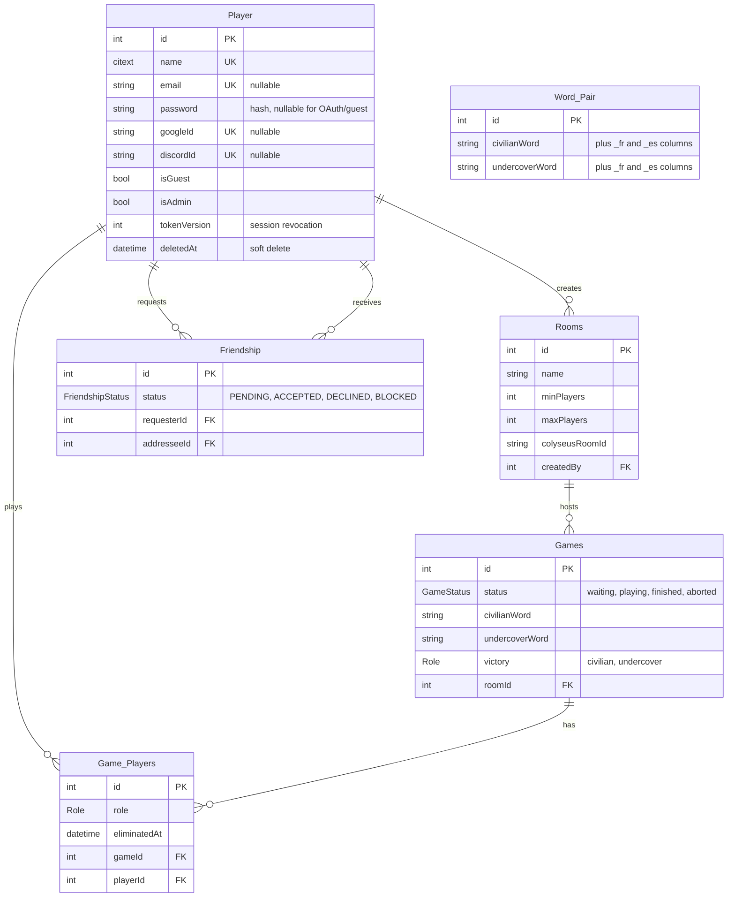

*This project has been created as part of the 42 curriculum by lcalero, thmaitre, alarroye, ekeisler.*

# UnderCover

## Description

**UnderCover** is an online social-deduction word game. Every player in a room
gets a secret word: civilians share the same word, the undercover player gets
a different but related one. Players take turns giving a one-word clue, then
vote to eliminate whoever they suspect. Civilians win by unmasking the
undercover, the undercover wins by surviving.

Key features:

- Accounts with email/password, Google or Discord OAuth, or a quick guest login
- Realtime multiplayer rooms (3 to 6 players, spectators allowed) with chat,
  turn timers, voting and reconnection
- Friends with live online status and room invitations
- Player profiles with avatar, bio and game statistics
- Admin dashboard (players, rooms, word pairs, counters)
- Interface and word pairs available in English, French and Spanish

## Instructions

### Prerequisites

- Docker with Docker Compose v2 (rootless Docker works: only ports above 1024
  are published by default)
- `make`

### Setup

1. Create the env files from their templates:
   ```bash
   cp .env.example srcs/.env    # then set PROJECT_PATH=<absolute path of the repo>
   cp srcs/containers/back/project_volume/.env.example srcs/containers/back/project_volume/.env
   cp srcs/containers/front/front_data/.env.example srcs/containers/front/front_data/.env
   ```
2. Create the Docker secrets in `srcs/secrets/`, one value per file (git-ignored,
   checked by `make check-secrets`):
   `db_user.txt`, `db_password.txt`, `db_name.txt`, `jwt_secret.txt`,
   `internal_api_key.txt`, `admins.txt` (one `name:email:password` per line),
   `google_client_id.txt`, `google_client_secret.txt`,
   `discord_client_id.txt`, `discord_client_secret.txt`.
   The OAuth apps must use the redirect URIs
   `https://localhost:8443/api/auth/{google,discord}/callback`.

### Run

| | `make dev` | `make prod` |
|---|---|---|
| Use it for | coding | evaluation / production |
| Front | Vite dev server, hot reload | optimized build served by NGINX |
| Back | source mounted, restarts on save | compiled build, production packages only |
| Data | demo players and games seeded once | admin accounts and word pairs only |
| Runs | attached (`Ctrl+C` to stop) | in the background (`make logs` to follow) |

Open **`https://localhost:8443`** (`http://localhost:8080` redirects to it).
The certificate is self-signed, so the browser warns once: choose
*Advanced → Continue to localhost*.

```bash
make down       # stop (keeps data)
make logs       # follow logs (logs-back / logs-front / logs-nginx)
make check-all  # lint + typecheck + tests (dev stack must be running)
make fclean     # remove containers, images and data volumes (asks first)
make help       # every target
```

Details and troubleshooting: [`docs/runbook.md`](docs/runbook.md).

## Resources

- [NestJS](https://docs.nestjs.com/) · [Prisma](https://www.prisma.io/docs) ·
  [PostgreSQL](https://www.postgresql.org/docs/) ·
  [Colyseus](https://docs.colyseus.io/)
- [React](https://react.dev/) · [Vite](https://vite.dev/guide/) ·
  [Tailwind CSS](https://tailwindcss.com/docs) · [Base UI](https://base-ui.com/) ·
  [i18next](https://www.i18next.com/)
- [Docker Compose](https://docs.docker.com/compose/) ·
  [NGINX](https://nginx.org/en/docs/) ·
  [OWASP Cheat Sheets](https://cheatsheetseries.owasp.org/)

### AI usage

> We used AI assistants as helpers, never as a replacement for understanding
> the code. Every AI-generated change was read, tested in the running app and
> reviewed by another team member through a PR before merging, as Chapter I of
> the subject requires.

| Tool | Tasks |
|---|---|
| Claude (Anthropic) | Explaining concepts that were new to us (e.g. WebSocket state sync with Colyseus, the OAuth2 code flow, httpOnly cookies and CSRF, HTTP rate limiting), so we could then implement them ourselves |
| Claude Code (Anthropic) | Reviewing our code and running lint, typecheck and tests on the changes |
| Claude Code (Anthropic) | Rewriting the docs to match the code, and checking the README against the subject |
| Claude Code (Anthropic) | Drafting commit messages, PR descriptions and issues from our templates |

> What we did not delegate to AI: the game idea and rules, the choice of
> modules and stack, the database design, and the final review of every PR.
> AI output was sometimes wrong (for example, it first described our OAuth as
> going through Passport), so we checked everything against the code and the
> tests.

## Team Information

| Login | Role(s) |
|---|---|
| lcalero | PO |
| thmaitre | Tech Lead |
| ekeisler | PM |
| alarroye |  Developer |

## Project Management

- **Tasks:** GitHub Issues with typed templates (`feat`, `fix`, `docs`, …) in
  `.github/ISSUE_TEMPLATE/`. Status labels (to-do → in progress → in review)
  are moved automatically by GitHub Actions from branch and PR events.
- **Workflow:** one branch per issue (`<type>/<issue>-<slug>`), PR template
  with a test checklist, CODEOWNERS review, CI must pass (lint, typecheck,
  tests, Docker build). See [`docs/engineering-guidelines.md`](docs/engineering-guidelines.md).
- **Communication channels:** Discord / PR discussions.

## Technical Stack

| Layer | Technologies | Why |
|---|---|---|
| Frontend | React 19, TypeScript, Vite, Tailwind CSS 4, Base UI, react-router, i18next | Component model and ecosystem the team knows; Vite for fast reloads |
| Backend | NestJS 11 (Express), TypeScript, Passport JWT, OAuth2 (Google, Discord) | Modules, guards and DTO validation out of the box |
| Realtime | Colyseus 0.17 (same process as the API) | Authoritative room state synced to clients, see [ADR 0001](docs/adr/0001-adopt-colyseus-for-realtime-game-sync.md) |
| Database | PostgreSQL 16 with Prisma 7 | Relational data (players, rooms, games, friendships), type-safe client and migrations |
| Infra | Docker Compose (dev / prod), NGINX (HTTPS, reverse proxy, security headers), Docker secrets | Single entry point, no credentials in env vars or images |

## Database Schema



Source of truth: [`prisma/schema.prisma`](srcs/containers/back/project_volume/prisma/schema.prisma).

## Features List

| Feature | Description |
|---|---|
| Authentication | Register/login with password policy, remember me, httpOnly cookie session, logout revokes every token |
| OAuth | Login with Google or Discord |
| Guest access | Play with a username only; guests cannot add friends or upload avatars |
| Profiles | Public profile page, bio, avatar upload, games played, victories, win rate |
| Friends | Send / accept / decline / remove requests, live online status |
| Lobby | Create a room, share the link, invite online friends, kick or ban players |
| Game | Roles and word pair per game, turn-based clues, voting, reveal, timers, spectators, chat |
| Reconnection | Rejoin a running game after a refresh; opening the game in a new tab takes over the seat |
| Admin dashboard | Counters, player list, room list, word pair management |
| Internationalization | English, French and Spanish UI and word pairs |
| Security | HTTPS, CSP and security headers, CSRF origin check, DTO validation, hashed passwords, Docker secrets |

## Modules

| Module | Type | Points | Justification | Implementation |
|---|---|---|---|---|
| Web: frameworks for frontend and backend | Major | 2 | Structured code, routing, guards and validation without reinventing them | React 19 (Vite, react-router) on the front, NestJS 11 on the back |
| Web: real-time features with WebSockets | Major | 2 | A turn-based party game needs every client to see the same state instantly | Colyseus rooms sync the state to every client; disconnects get a reconnection window; presence pushes notifications |
| Web: user interaction | Major | 2 | A social game needs players to talk, find each other and play again together | In-room chat, public profiles (`/profile/:name`), friends system (add, accept, remove, list) |
| Web: ORM | Minor | 1 | Type-safe queries and versioned migrations | Prisma 7 on PostgreSQL, migrations applied at every start |
| Web: custom-made design system | Minor | 1 | One consistent identity across every page, and faster UI work by reusing pieces instead of restyling them | Colour tokens in Tailwind `@theme`, fluid type scale, lucide-react and custom SVG mask icons, 15+ shared components; see [`docs/design-system.md`](docs/design-system.md) |
| Accessibility: multiple languages | Minor | 1 | The team and players speak English, French and Spanish | i18next with `en`, `fr`, `es` locales and a language switcher; word pairs stored in all 3 languages |
| User Management: standard user management | Major | 2 | Players need an identity that persists between games | Profile edit, avatar upload with a default avatar, friends with live online status, profile page with stats |
| User Management: remote authentication with OAuth 2.0 | Minor | 1 | One-click sign-in without creating a password | OAuth2 code flow for Google and Discord, accounts linked by provider id |
| Gaming: complete web-based game | Major | 2 | UnderCover is the core of the project | Server-authoritative game loop: roles and word pair, clues turn by turn, voting, reveal, win/loss for civilians or undercover |
| Gaming: remote players | Major | 2 | Players are on separate computers by design | Colyseus over WSS behind NGINX; reconnection after a refresh or a drop; a new tab takes over the seat |
| Gaming: multiplayer (more than 2 players) | Major | 2 | UnderCover needs at least 3 players to make sense | 3 to 6 participants per game, server-side turns and timers keep every client in sync |
| Gaming: spectator mode | Minor | 1 | Friends can watch a game or wait for the next one | Clients beyond the participants join as spectators (up to 12 per room), get live updates and can use the chat |

**Total:** 7 Major × 2 + 5 Minor × 1 = **19 points** (14 required)

## Further documentation

- [`docs/architecture.md`](docs/architecture.md): services, auth, API and realtime design
- [`docs/runbook.md`](docs/runbook.md): commands, database and troubleshooting
- [`docs/design-system.md`](docs/design-system.md): colour palette, typography, icons and reusable components
- [`docs/engineering-guidelines.md`](docs/engineering-guidelines.md): workflow and conventions
- [`docs/adr/`](docs/adr/): architecture decision records
