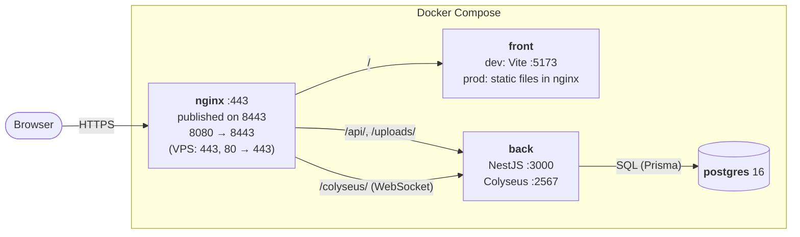

# Architecture

## Overview

Compose runs three services behind NGINX, the only entry point:

The front uses same-origin URLs (`/api`, `wss://<host>/colyseus`), so
NGINX strips `/api` before proxying to Nest. NGINX also sets the CSP and
security headers (`nginx/conf/security-headers.conf`, CSP per mode in
`dev.conf.template` / `prod.conf.template`), and answers `404` on every
`/<resource>/internal/...` route. Dev and prod modes are described in the
[runbook](runbook.md#dev-and-prod-modes).

## front: `srcs/containers/front/front_data`

- React 19, TypeScript, Vite, Tailwind CSS 4, Base UI components.
- Routes (`src/App.tsx`): `/home`, `/login`, `/register`, `/guest`,
  `/auth/callback` (OAuth), `/profile`, `/profile/:name`,
  `/create-room/:roomId?` (lobby), `/game/:id`, `/admin`. Pages live in
  `src/pages/<Page>/` with page-local `components/`.
- Auth state lives in `src/context/AuthContext.tsx`. The session is an
  httpOnly cookie set by the back, so the front never sees the token.
  `apiFetch()` (`src/api/auth/client.ts`) wraps every REST call. On a `401`
  it logs the user out, and a `BroadcastChannel` spreads that logout to the
  other tabs.
- Colyseus is used through `@colyseus/react`. The client keeps
  reconnection data so a refresh rejoins the same seat
  (`src/lib/roomReconnection.ts`).
- i18n: `src/i18n.ts` + `src/locales/{en,fr,es}.json`. The chosen
  language is stored in `localStorage`.

## back: `srcs/containers/back/project_volume`

- NestJS 11 (Express) + Prisma 7. One module per domain: `auth`, `player`,
  `room`, `game`, `word_pair`, `friendship`, `bootstrap`, plus `colyseus/`
  (realtime) and `common/` (guards, policies, helpers).
- **Auth** (`src/auth/`):
  - Bcrypt passwords, guest accounts, and an OAuth2 code flow for Google
    and Discord (`oauth/oauth.service.ts`, providers in
    `oauth.providers.ts`).
  - The JWT lives in an httpOnly, `SameSite=Lax` cookie
    (`auth-cookie.ts`). Lifetime is `JWT_EXPIRES_IN` (1d), or
    `JWT_REMEMBER_EXPIRES_IN` (30d) with remember me.
  - Logout bumps `Player.tokenVersion`, which revokes every issued token.
- **Guards:**
  - `JwtAuthGuard` for logged-in routes.
  - `NotGuestGuard` blocks guests from friends, profile edits and avatar
    upload.
  - `@adminOnly()` + `RolesGuard` restrict admin routes.
  - `InternalApiKeyGuard` (`x-internal-api-key`) protects the
    `/internal/` routes that Colyseus calls.
- **Request hygiene:**
  - A global `ValidationPipe` (`whitelist`, `forbidNonWhitelisted`)
    rejects unknown DTO fields.
  - `csrf-origin.middleware.ts` rejects any request other than
    GET/HEAD/OPTIONS whose `Origin` is not `CORS_ORIGIN`.
  - `trust proxy` is on, so the back sees the real client IP from NGINX.
- `src/bootstrap/` creates or updates the admin accounts (`admins.txt`)
  and the word pairs (`word-pairs.data.ts`) at every start. Uploaded
  avatars are served from `/uploads`.

### API surface

| Resource | Routes |
|---|---|
| `auth` | `GET /auth/:provider`, `GET /auth/:provider/callback`, `POST /auth/register`, `POST /auth/login`, `POST /auth/guest`, `POST /auth/logout` |
| `player` | `GET /player`, `GET /player/count-activ`, `GET /player/me`, `GET /player/profile/:name`, `GET/PATCH/DELETE /player/:id`, `GET /player/:id/games`, `GET /player/:id/games-played`, `GET /player/:id/victory`, `GET /player/:id/winrate`, `GET /player/:id/about-me`, `PATCH /player/:id/avatar` |
| `room` | `POST /room`, `GET /room`, `GET /room/current`, `GET /room/count-activ`, `GET /room/live/:colyseusRoomId/banned`, `GET /room/:id`, `GET /room/:id/games`, `PATCH/DELETE /room/:id`, `DELETE /room/internal/:id` |
| `game` | `GET /game`, `GET /game/count`, `GET /game/:id`, `GET /game/:id/players`, `GET /game/:id/my-word`, `POST /game/internal`, `PATCH /game/internal/:id/eliminate`, `PATCH /game/internal/:id/finish`, `DELETE /game/internal/:id` |
| `word-pair` | `POST /word-pair`, `GET /word-pair`, `GET/PATCH/DELETE /word-pair/:id` (admin), `GET /word-pair/internal` |
| `friendship` | `POST /friendship`, `GET /friendship?status=`, `GET/PATCH/DELETE /friendship/:id` |

The data model is described in the
[README](../README.md#database-schema).

## Realtime: `back/src/colyseus/`

The Colyseus server (`server.ts`) runs in the same process as the API on
port `2567`. It is not published, and browsers reach it through NGINX.
Both rooms authenticate with the session cookie (`onAuth`). The reasons
for choosing Colyseus are in [ADR 0001](adr/0001-adopt-colyseus-for-realtime-game-sync.md).

- **`undercover`** (`UndercoverRoom.ts`, state in `UndercoverState.ts`):
  - **Lobby:** phase `setup` is the private lobby on `/create-room`.
    There the host invites friends, kicks or bans players, and sends
    `start`.
  - **Start:** the room is saved in the database (`RoomPersistence.ts`)
    and goes public. Every client gets a seat reservation
    (`matchMaker.reserveSeatFor`), which it redeems on `/game/:id`.
  - **Game loop:** `UndercoverGame.ts` + `undercoverGameLogic.ts` run
    `open → starting → describing → voting → reveal → finished`, with
    server-side timers (`undercoverConstants.ts`). It picks the word pair
    and the roles, collects clues turn by turn, resolves votes, and saves
    the game through the internal API.
  - **Sessions:** spectators are allowed up to `MAX_CLIENTS`. Disconnects
    get a reconnection window, and joining from a new tab takes over the
    existing seat.
- **`presence`** (`PresenceRoom.ts` + `presence-pubsub.ts`): one connection
  per logged-in player. It tracks who is online and pushes friend
  requests, friendship updates, room invites and `roomsChanged`
  notifications.

## Configuration & secrets

- Non-secret config: `srcs/.env`, the back `.env` and
  `front_data/.env` (see the [README](../README.md#setup)).
- Credentials (DB, JWT secret, internal API key, admins, OAuth) live in
  `srcs/secrets/*.txt` and are mounted as Docker secrets. The back
  entrypoint loads them through `conf/load-secrets.sh`.

## CI

The `ci-*` workflows in `.github/workflows/` run on every PR:

- `ci-lint-eslint.yaml`: ESLint, front and back
- `ci-typecheck.yaml`: `tsc`, front and back
- `ci-test.yaml`: backend Jest tests
- `ci-docker-build.yaml`: builds and launches the stack

The `automation-*` workflows move issue and PR status labels (see the
[engineering guidelines](engineering-guidelines.md)).
